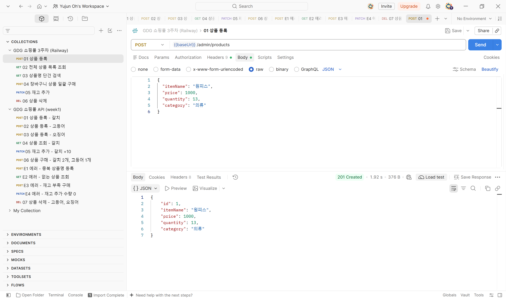
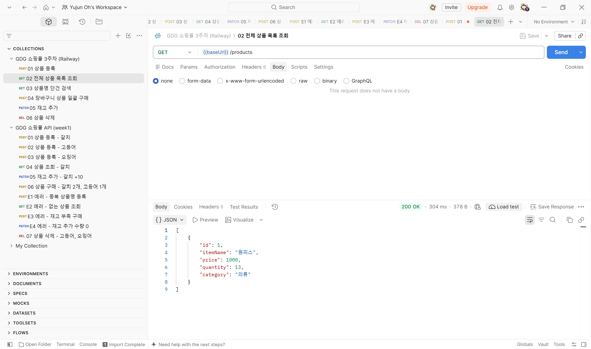
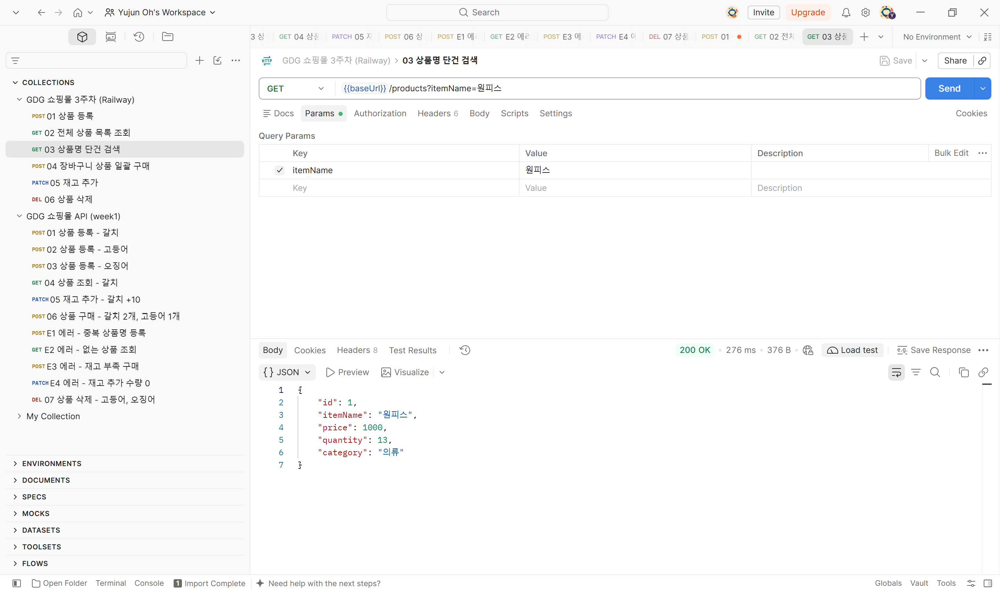
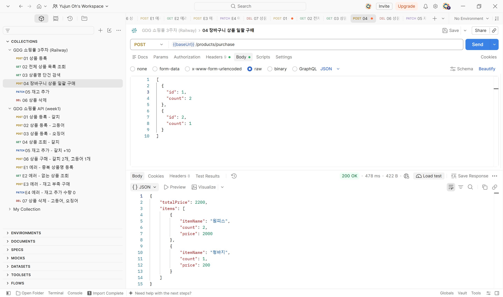
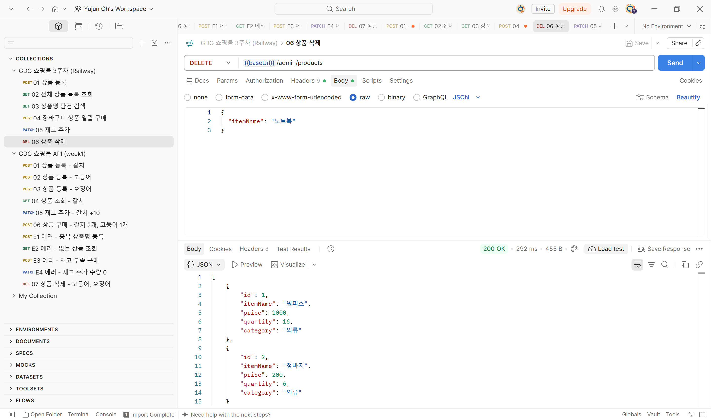
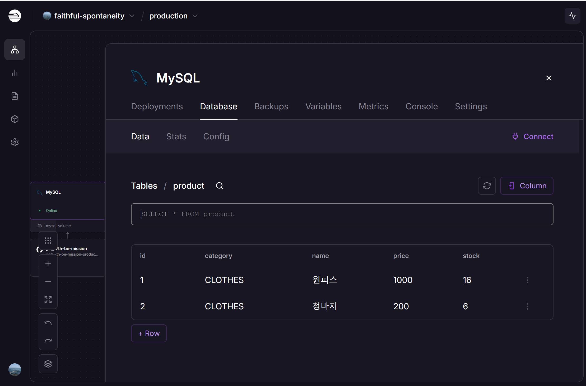

# 3주차 미션

## 배포 URL

https://gdg-7th-be-mission-production-065d7dad.up.railway.app

- 전체 상품 조회: https://gdg-7th-be-mission-production-065d7dad.up.railway.app/products
- Swagger: https://gdg-7th-be-mission-production-065d7dad.up.railway.app/swagger-ui/index.html

Railway에 서버와 MySQL을 올렸고, 공식 API 명세에 맞춘 코드로 배포했습니다.

## Postman 테스트 (배포 서버)

### 1. 상품 등록 `POST /admin/products`

### 2. 전체 상품 목록 조회 `GET /products`

### 3. 상품명 단건 검색 `GET /products?itemName=원피스`

### 4. 장바구니 상품 일괄 구매 `POST /products/purchase`

### 5. 재고 추가 `PATCH /admin/products/stock`

### 6. 상품 삭제 `DELETE /admin/products`

## MySQL Product 테이블

